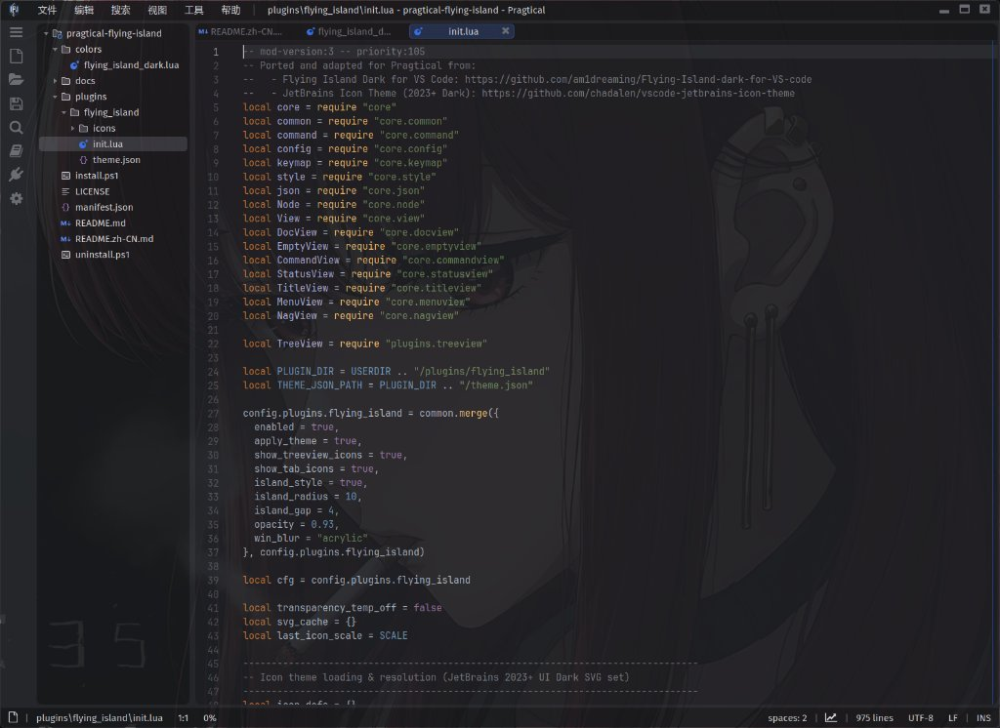
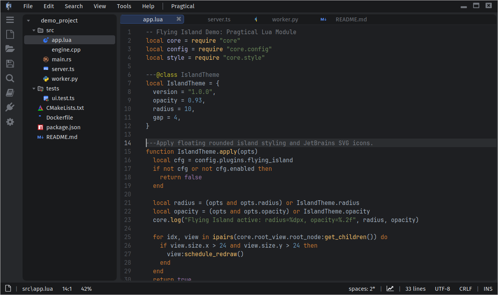

# pragtical-flying-island

**English** | [简体中文](README.zh-CN.md)

[](https://pragtical.dev/)
[](https://github.com/TongshiWang/pragtical-flying-island/releases)
[](LICENSE)

> **Ported From / Credits**
> - UI design, floating islands palette, and translucency style ported from **[am1dreaming/Flying-Island-dark-for-VS-code](https://github.com/am1dreaming/Flying-Island-dark-for-VS-code)**
> - 120 SVG icons sourced from **[chadalen/vscode-jetbrains-icon-theme](https://github.com/chadalen/vscode-jetbrains-icon-theme)** (JetBrains 2023+ UI Dark icon set)

Bring the **JetBrains New UI Floating Islands**, **JetBrains 2023+ Dark SVG file/folder icons**, **Darcula Contrast color theme**, and **translucent Windows 11 DWM blur** to [Pragtical](https://pragtical.dev/).

<p align="center">
  
</p>

<p align="center">
  
</p>

---

## Features

- **JetBrains 2023+ Dark SVG Icons**:
  - Bundles 120 high-DPI SVG icons with `theme.json` filename, compound-extension (`*.test.ts`, `CMakeLists.txt`, `Dockerfile`, `package.json`), and folder mappings (`tests`, `.github`, root module).
  - Rasterizes & caches SVGs cleanly via Pragtical's native `canvas.load_svg_image` in both **TreeView** and **Document Tabs**.
- **Floating Rounded Islands UI**:
  - Frames TreeView (`#191A1C`) and editor leaf panes (`#1E1F22`) as rounded floating islands (default `10px` corner radius, `4px` outer gap in `#26282B`).
  - Pill-shaped active editor tab (`#25324D` fill, `#35538F` outline), rounded TreeView selection pills (`#2E436E`), vector chevrons, and rounded Toolbar highlights.
- **Window Transparency & Windows 11 Native Blur**:
  - Adjustable window opacity (`0.93` by default) via `system.set_window_opacity`.
  - On Windows 11, uses LuaJIT `ffi` to enable native Dark Mode title frame, rounded window corners, DWM System Backdrop (`Acrylic`, `Mica`, `Tabbed`), and `Blur Behind`.
- **Flying Island Dark Theme (`colors/flying_island_dark.lua`)**:
  - Auto-applied on startup (unless disabled in Settings or overridden by another chosen theme), combining JetBrains New UI surface colors with Darcula Contrast syntax highlighting.

---

## Platform Compatibility

Tested on **Pragtical 3.15.0-jit** (`mod-version: 3`).

| Feature | Windows 10 / 11 | Linux | macOS |
| :--- | :---: | :---: | :---: |
| Flying Island Dark color scheme | Yes | Yes | Yes |
| JetBrains 2023+ SVG icons (Tree & Tabs) | Yes | Yes | Yes |
| Floating rounded islands & pill tabs | Yes | Yes | Yes |
| Window opacity (`system.set_window_opacity`) | Yes | Depends on WM/compositor | Yes |
| Native DWM Acrylic / Mica / Tabbed blur | Windows 11 | Skipped cleanly | Skipped cleanly |

---

## Installation

### Method 1: PPM / Plugin Manager (Recommended — Windows / Linux / macOS)

Now included in the official `pragtical/plugins` and `pragtical/colors` repositories! Install with a single command via `ppm`:

```sh
ppm install flying_island
```

- Or search for **`flying_island`** directly inside Pragtical's **Tools > Plugin Manager** and click **Install**.
- To install only the standalone dark color scheme: `ppm install flying_island_dark`.
- *(Optional)* To track bleeding-edge `main` directly: `ppm repo add https://github.com/TongshiWang/pragtical-flying-island.git:main` before running `ppm install flying_island`.

### Method 2: PowerShell Installer (Windows)

```powershell
git clone https://github.com/TongshiWang/pragtical-flying-island.git
cd pragtical-flying-island
.\install.ps1
```

### Method 3: Manual Install

Copy the files into your Pragtical `USERDIR`:
- `plugins/flying_island/` -> `<USERDIR>/plugins/flying_island/`
- `colors/flying_island_dark.lua` -> `<USERDIR>/colors/flying_island_dark.lua`

Common `USERDIR` locations:
- **Windows (Installer / Portable with `user` folder)**: `%LOCALAPPDATA%\Programs\Pragtical\user`
- **Windows (Config dir)**: `%USERPROFILE%\.config\pragtical`
- **Linux / macOS**: `~/.config/pragtical`

Restart Pragtical after installing.

---

## Shortcuts & Settings

Control everything live from **Tools > Settings > Plugins > Flying Island**, **View > Flying Island**, or via hotkeys:

| Shortcut | Action |
| :--- | :--- |
| `Ctrl+Alt+T` | Toggle window transparency on/off |
| `Ctrl+Alt+=` | Increase window opacity (+3%) |
| `Ctrl+Alt+-` | Decrease window opacity (-3%) |

Configurable options include: `enabled`, `apply_theme`, `show_treeview_icons`, `show_tab_icons`, `island_style`, `island_radius`, `island_gap`, `opacity`, and `win_blur` (`acrylic` / `mica` / `tabbed` / `blur` / `off`).

---

## Uninstallation

- **If installed via PPM**:
  ```sh
  ppm uninstall flying_island flying_island_dark
  ```
- **If installed via PowerShell on Windows**:
  ```powershell
  .\uninstall.ps1
  ```
- **Manual**: Delete `<USERDIR>/plugins/flying_island` and `<USERDIR>/colors/flying_island_dark.lua`, then restart Pragtical.

---

## License

[MIT License](LICENSE)
