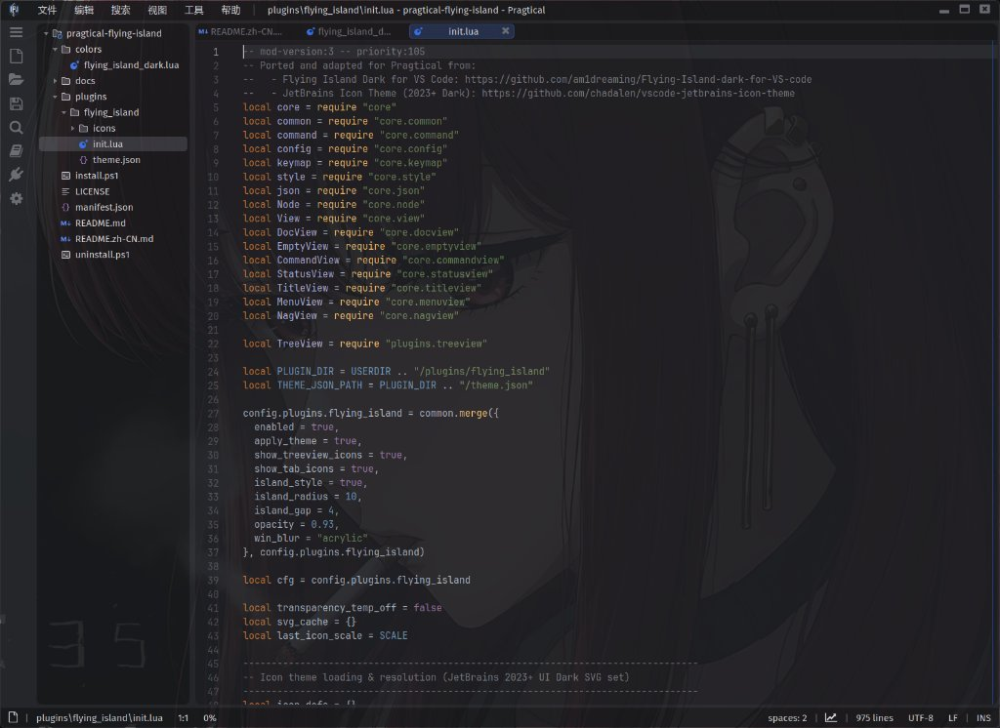
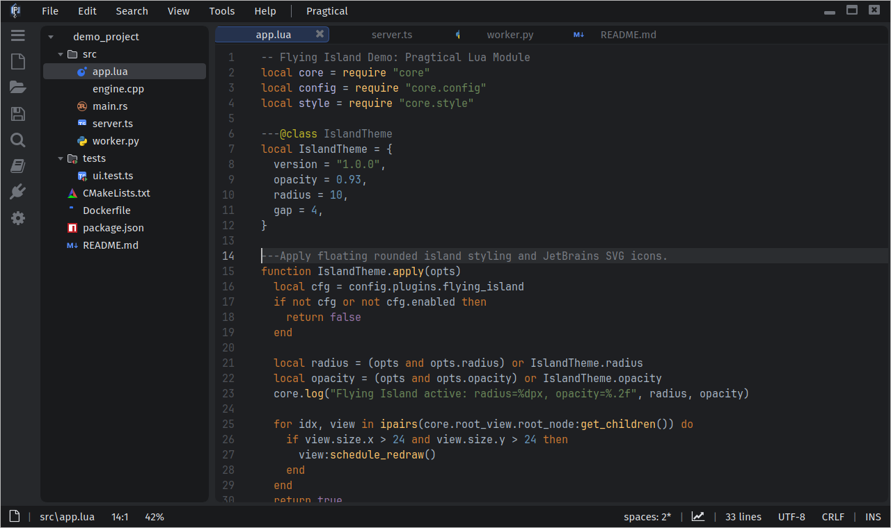

# pragtical-flying-island

[English](README.md) | **简体中文**

[](https://pragtical.dev/)
[](https://github.com/TongshiWang/pragtical-flying-island/releases)
[](LICENSE)

> **改造来源 / Ported From**
> - 本项目改造移植自 VS Code 主题与界面增强项目：**[am1dreaming/Flying-Island-dark-for-VS-code](https://github.com/am1dreaming/Flying-Island-dark-for-VS-code)**
> - 图标资源来自：**[chadalen/vscode-jetbrains-icon-theme](https://github.com/chadalen/vscode-jetbrains-icon-theme)**（JetBrains 2023+ Dark SVG 图标集）

为 [Pragtical](https://pragtical.dev/) 打造的 **Flying Island Dark** 视觉插件与配色主题（`mod-version: 3`），带来 JetBrains New UI 圆角浮岛布局、120 枚彩色 SVG 图标以及 Windows 11 原生透明模糊质感。

<p align="center">
  
</p>

<p align="center">
  
</p>

---

## 功能特性与模块化自由开关

Flying Island 的每一个视觉领域都可以单独开关，可在 **工具 > 设置 > 插件 > Flying Island** 或 **视图 > Flying Island** 中自由组合：

- **JetBrains 2023+ Dark 彩色 SVG 图标**（`show_treeview_icons` / `show_tab_icons`）：
  - 内置 120 个矢量 SVG 图标与 `theme.json` 映射规则（覆盖常见后缀、`CMakeLists.txt`、`Dockerfile`、`package.json`、`*.test.ts` 与特殊文件夹）。
  - **文件树图标**与**标签栏图标**支持独立开关；即使关闭胶囊标签页，标签栏 SVG 图标依然可完美搭配原生标签页渲染。
- **Floating Islands 圆角浮岛界面**（`island_style` 总开关 + 4 个独立子模块：`island_panels`、`pill_tabs`、`rounded_tree_rows`、`styled_toolbar`，以及 `island_radius` / `island_gap`）：
  - **圆角悬浮面板浮岛**（`island_panels`）：将文件树（`#191A1C`）与编辑区窗格（`#1E1F22`）框选为圆角悬浮浮岛（默认 `10px` 圆角、`4px` 间距）。
  - **胶囊式编辑器标签页**（`pill_tabs`）：当前活动标签与悬停标签显示为圆角胶囊样式（`#25324D` 填充 + `#35538F` 描边）。
  - **文件树圆角选中行与矢量箭头**（`rounded_tree_rows`）：圆角选中行（`#2E436E`）、高对比文字与矢量折叠箭头。
  - **自定义暗色活动工具栏**（`styled_toolbar`）：`#26282B` 活动条背景与圆角图标悬停高亮。
- **窗口透明与 Windows 11 原生 DWM 模糊**（`enable_transparency` / `opacity` / `win_blur`）：
  - 支持独立开关透明与毛玻璃效果（`enable_transparency`）、调节窗口不透明度（默认 `0.93`）以及选择 Win11 DWM 背景合成模式（Acrylic / Mica / Tabbed / Blur Behind / Off）。
- **配套 Flying Island Dark 配色主题（`colors/flying_island_dark.lua`）**（`apply_theme`）：融合 JetBrains New UI 暗色调与 Darcula Contrast 语法高亮，可随时独立关闭以搭配其他喜欢的配色方案。

### 常见自由组合方案

- **纯 SVG 图标模式**：关闭 `island_style`、`enable_transparency`（按需关闭 `apply_theme`），在保留现有主题与界面布局的同时只使用 JetBrains SVG 图标。
- **纯圆角浮岛、关闭窗口透明**：保持 `island_style = true`，关闭 `enable_transparency` 即可获得不透明的纯粹 JetBrains 浮岛界面。
- **只要胶囊标签 + 图标、不要外层浮岛边框**：仅关闭 `island_panels`，其余选项保持开启。

---

## 兼容性

已在 **Pragtical 3.15.0-jit**（`mod-version: 3`）实测通过：

| 功能项 | Windows 10 / 11 | Linux | macOS |
| :--- | :---: | :---: | :---: |
| Flying Island Dark 配色主题 | 支持 | 支持 | 支持 |
| JetBrains 2023+ SVG 图标（文件树 + 标签页） | 支持 | 支持 | 支持 |
| 圆角浮岛与胶囊标签 UI | 支持 | 支持 | 支持 |
| 窗口不透明度（`system.set_window_opacity`） | 支持 | 视桌面合成器而定 | 支持 |
| Win11 DWM Acrylic / Mica / Tabbed 模糊 | Windows 11 原生支持 | 自动跳过 | 自动跳过 |

---

## 安装方法

### 方式一：通过 PPM / 官方插件管理器安装（推荐，全平台适用）

现已正式收录进 Pragtical 官方插件与配色目录！一行命令即可安装：

```sh
ppm install flying_island
```

- 也可以直接在 Pragtical 中打开 **工具 > 插件管理器 (Plugin Manager)**，搜索 **`flying_island`** 一键安装。
- 若仅需独立配色方案：`ppm install flying_island_dark`。
- *（可选）* 如需抢先体验 `main` 分支最新提交，可先执行 `ppm repo add https://github.com/TongshiWang/pragtical-flying-island.git:main`。

### 方式二：PowerShell 一键安装（Windows）

```powershell
git clone https://github.com/TongshiWang/pragtical-flying-island.git
cd pragtical-flying-island
.\install.ps1
```

### 方式三：手动安装

将文件复制到 Pragtical 的用户配置目录 `<USERDIR>`：
- `plugins/flying_island/` -> `<USERDIR>/plugins/flying_island/`
- `colors/flying_island_dark.lua` -> `<USERDIR>/colors/flying_island_dark.lua`

常见 `<USERDIR>` 路径说明：
- **Windows 默认安装包（含内置 `user` 目录）**：`%LOCALAPPDATA%\Programs\Pragtical\user`
- **Windows 标准配置目录**：`%USERPROFILE%\.config\pragtical`
- **Linux / macOS**：`~/.config/pragtical`

安装完成后重启 Pragtical 即可生效。

---

## 快捷键与设置

可在 **设置 > 插件 > Flying Island** 中实时调整全部 14 项独立开关与参数，或使用顶部菜单 **视图 > Flying Island** 与以下快捷键：

| 快捷键 | 功能 |
| :--- | :--- |
| `Ctrl+Alt+T` | 切换窗口透明效果 |
| `Ctrl+Alt+=` | 提高窗口不透明度（+3%） |
| `Ctrl+Alt+-` | 降低窗口不透明度（-3%） |

可配置项包括：`enabled`、`apply_theme`、`show_treeview_icons`、`show_tab_icons`、`island_style`、`island_panels`、`island_radius`、`island_gap`、`pill_tabs`、`rounded_tree_rows`、`styled_toolbar`、`enable_transparency`、`opacity` 与 `win_blur`。

---

## 卸载方法

- **PPM 安装**：`ppm uninstall flying_island flying_island_dark`
- **Windows 脚本**：在仓库目录运行 `.\uninstall.ps1`
- **手动卸载**：删除 `<USERDIR>/plugins/flying_island` 与 `<USERDIR>/colors/flying_island_dark.lua` 后重启 Pragtical。

---

## 许可证

[MIT License](LICENSE)
